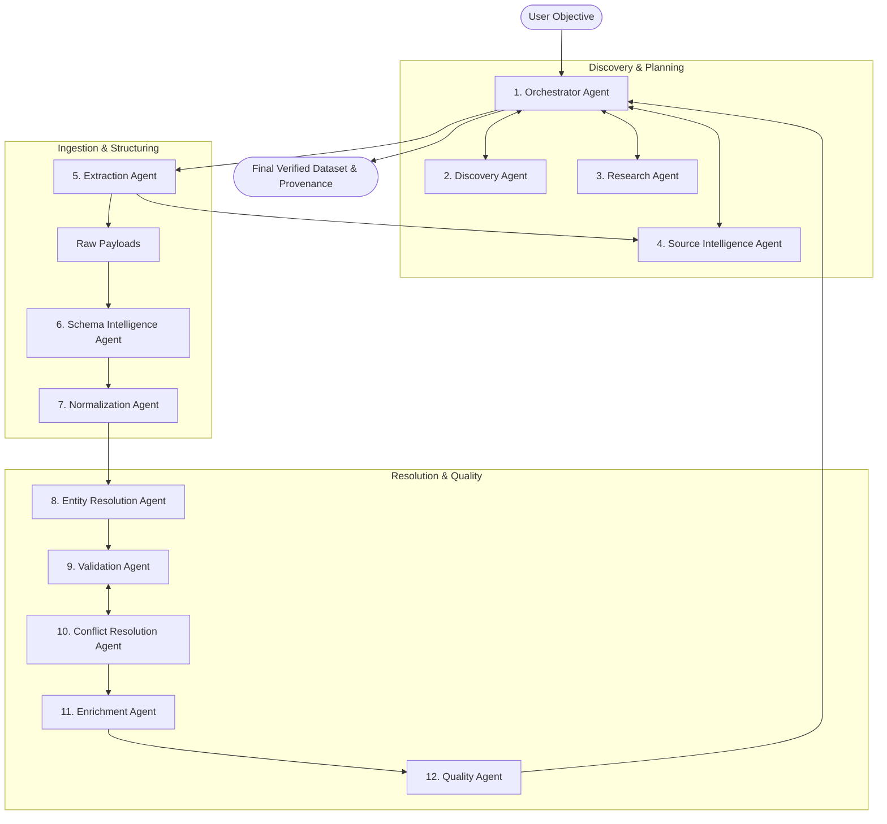

# Multi-Agent Architecture Specification

## 1. Multi-Agent Philosophy: Hybrid AI + Deterministic Processing

A foundational mistake in early agentic systems is using Large Language Models (LLMs) for deterministic, computational, or repetitive operations. In UDCM:
- **LLMs are used ONLY where semantic interpretation, open-world planning, linguistic disambiguation, or subjective trade-offs are required.**
- **Deterministic algorithms are used EXCLUSIVELY for arithmetic, filtering, coordinate transforms, regex parsing, spatial indexing, hash comparisons, and high-throughput vector transformations.**

The multi-agent workforce consists of **12 specialized agents**, coordinated by an Orchestrator. Each agent has a strictly bounded contract, defined inputs/outputs, a explicit toolset, and a clear distinction between cognitive reasoning and deterministic execution.

---

## 2. Agent Interaction & Topology

---

## 3. The 12 Specialized Agents

### 3.1 Orchestrator Agent
* **Purpose**: Mission conductor, plan synthesizer, lifecycle manager, and inter-agent coordinator.
* **Responsibilities**:
  * Deconstruct user objectives into execution DAGs.
  * Allocate tasks to specialized agents.
  * Monitor progress, budget, and timeouts.
  * Handle mission-level exceptions, trigger rollbacks, or activate fallback collection strategies.
* **Inputs**: User Objective string, Mission Configuration, Domain Plugin metadata.
* **Outputs**: `MissionPlan`, stage status events, final mission report.
* **Tools**: DAG Scheduler, State Machine Controller, Budget Monitor, Event Dispatcher.
* **Dependencies**: None (Top-level agent).
* **Possible Failure Modes**: Hallucinated dependencies in DAG, deadlocks, infinite retry loops.
* **Interactions**: Communicates with all agents; receives feedback from Validation and Quality agents.
* **LLM Reasoning vs Deterministic Code**:
  * *Requires LLM*: Plan synthesis, natural language goal parsing, strategy adaptation upon failure.
  * *Deterministic Code Preferable*: DAG topological sorting, state transitions, timeout/budget tracking.

---

### 3.2 Discovery Agent
* **Purpose**: Identifies potential web sources, public APIs, spatial servers, and data catalogs relevant to the mission.
* **Responsibilities**:
  * Formulate search queries for web search engines and specialized open-data portals (e.g., data.gov, OpenStreetMap, GeoFabrik, Kaggle).
  * Filter candidate URLs based on relevance, geographic match, and domain reputation.
* **Inputs**: Target entity types, geographic boundaries, domain keywords.
* **Outputs**: List of candidate source descriptors (`CandidateSource[]`).
* **Tools**: Web Search API, CKAN Data Portal Query Client, Overpass Wizard Generator, Domain Registry Inspector.
* **Dependencies**: Orchestrator Agent.
* **Possible Failure Modes**: Source hallucinations, selecting stale or dead URLs, rate-limited search APIs.
* **Interactions**: Sends candidates to Research Agent and Source Intelligence Agent.
* **LLM Reasoning vs Deterministic Code**:
  * *Requires LLM*: Query formulation, interpreting search snippet relevance.
  * *Deterministic Code Preferable*: URL parsing, deduplication, domain extraction, robots.txt check.

---

### 3.3 Research Agent
* **Purpose**: Conducts background investigation into domain standards, licensing, authority, and documentation.
* **Responsibilities**:
  * Locate API documentation, schema definitions, data dictionaries, and license terms (e.g., ODbL, CC-BY, Public Domain).
  * Verify whether candidate sources legally and technically permit automated access.
* **Inputs**: Candidate source URLs, domain plugin specifications.
* **Outputs**: Source technical briefs (`SourceResearchBrief[]`), legal constraints.
* **Tools**: Documentation Fetcher, License Classifier, Robots.txt Evaluator.
* **Dependencies**: Discovery Agent.
* **Possible Failure Modes**: Misinterpreting complex legal terms, failing to find hidden documentation.
* **Interactions**: Provides feasibility advice to Orchestrator and Source Intelligence Agent.
* **LLM Reasoning vs Deterministic Code**:
  * *Requires LLM*: Summarizing messy API docs, interpreting human license text.
  * *Deterministic Code Preferable*: License regex matching, HTTP status checking.

---

### 3.4 Source Intelligence Agent
* **Purpose**: Evaluates candidate endpoints technically to determine access methods and expected format.
* **Responsibilities**:
  * Perform endpoint probing (`HEAD`/`OPTIONS` requests, sample page fetching).
  * Detect API structures (REST, GraphQL), pagination schemes, content types (JSON, CSV, PBF, HTML).
  * Estimate source volume, freshness, and server rate-limiting response codes.
* **Inputs**: Candidate URLs from Discovery/Research.
* **Outputs**: Endpoint capabilities profile (`SourceEndpointProfile`), recommended extraction strategy.
* **Tools**: HTTP Header Probe, SSL Inspector, Content-Type Sniffer, Rate Limit Estimator.
* **Dependencies**: Research Agent.
* **Possible Failure Modes**: Triggering IP bans during probing, misidentifying dynamic JavaScript-rendered pages as static.
* **Interactions**: Hands off extraction profiles to Extraction Agent.
* **LLM Reasoning vs Deterministic Code**:
  * *Requires LLM*: Synthesizing complex pagination patterns from ambiguous HTML/JSON.
  * *Deterministic Code Preferable*: Header inspection, SSL verification, mime-type detection, ping latency.

---

### 3.5 Extraction Agent
* **Purpose**: Executes the physical acquisition of raw payloads from target sources.
* **Responsibilities**:
  * Execute HTTP requests, headless browser sessions, API pagination loops, or bulk file downloads.
  * Enforce rate limits, exponential backoff, and retry policies.
  * Save raw uncompressed bytes with cryptographic SHA-256 hashes to the Raw Lake.
* **Inputs**: Endpoint profile, extraction parameters, credentials (if any).
* **Outputs**: Raw payload references (`RawPayloadRef[]`) with provenance metadata.
* **Tools**: Asynchronous HTTP Client (`httpx`), Browser Automation (`Playwright`), Stream Downloader, Hash Generator.
* **Dependencies**: Source Intelligence Agent.
* **Possible Failure Modes**: Network timeouts, 429/403 blocks, CAPTCHA hurdles, disk out-of-space.
* **Interactions**: Hands raw payload pointers to Schema Intelligence Agent.
* **LLM Reasoning vs Deterministic Code**:
  * *Requires LLM*: Generating dynamic selectors (XPath/CSS) for complex DOMs when static extractors fail.
  * *Deterministic Code Preferable*: **95% Deterministic**. Network I/O, streaming to disk, hashing, backoff algorithms.

---

### 3.6 Schema Intelligence Agent
* **Purpose**: Inactive schema inference, semantic column understanding, and cross-source schema mapping.
* **Responsibilities**:
  * Sample raw payloads and infer column datatypes, nesting, and structural cardinality.
  * Detect semantic meanings of obscure column names (e.g., `cd_stn` $\rightarrow$ `station_code`, `lat_wgs` $\rightarrow$ `latitude`).
  * Map source-specific attributes to the target canonical schema defined by the domain plugin.
* **Inputs**: Raw payload samples, Target Canonical Schema from Domain Plugin.
* **Outputs**: Schema Mapping Plan (`SchemaMapping[]`), Transformation Code/Expressions.
* **Tools**: DuckDB Sniffer, JSON Path Explorer, Semantic Embedding Matcher, LLM Code Synthesizer.
* **Dependencies**: Extraction Agent, Domain Plugin.
* **Possible Failure Modes**: Incorrect column mapping (e.g., swapping latitude and longitude), failure on unstructured text blobs.
* **Interactions**: Sends mapping specifications to Normalization Agent.
* **LLM Reasoning vs Deterministic Code**:
  * *Requires LLM*: Semantic column mapping, decoding cryptic domain acronyms.
  * *Deterministic Code Preferable*: Structural type inference (int, float, date regex), schema tree validation.

---

### 3.7 Normalization Agent
* **Purpose**: Executes deterministic data transformation and standardizes raw attribute values into canonical representations.
* **Responsibilities**:
  * Execute vectorized schema projections, cast types, clean string encodings (Unicode NFC).
  * Standardize datetime values to ISO-8601 UTC.
  * Standardize geographic coordinates to EPSG:4326 WGS84 with decimal precision formatting.
  * Stage normalized records into DuckDB columnar tables.
* **Inputs**: Raw data payloads, Schema Mapping Plan from Schema Intelligence Agent.
* **Outputs**: Staged normalized tables (`NormalizedRecordBatch`).
* **Tools**: DuckDB Engine, Polars Transform Pipelines, PyProj Coordinate Transformer, String Normalizers.
* **Dependencies**: Schema Intelligence Agent.
* **Possible Failure Modes**: Type cast exceptions, invalid coordinate projections, malformed datetime strings.
* **Interactions**: Sends normalized tables to Entity Resolution Agent.
* **LLM Reasoning vs Deterministic Code**:
  * *Requires LLM*: Almost none.
  * *Deterministic Code Preferable*: **100% Deterministic**. High-throughput vectorized transformations.

---

### 3.8 Entity Resolution Agent
* **Purpose**: Identifies duplicate records across multiple heterogeneous sources and clusters records describing the same real-world entity.
* **Responsibilities**:
  * Execute candidate pair blocking (spatial geo-hashing, phonetic blocking) to eliminate obvious non-matches.
  * Calculate attribute similarity vectors (Jaro-Winkler, Levenshtein, Jaccard, spatial distance).
  * Classify pairs into Matches, Non-Matches, and Borderline Ambiguities.
  * Invoke LLM reasoning solely for borderline ambiguous pairs.
  * Cluster matches into connected components and assign Universal Entity IDs (UEID).
* **Inputs**: Normalized record tables.
* **Outputs**: Entity Clustered Table with assigned UEIDs, Pair Match Ledger.
* **Tools**: Spatial KD-Tree/R-Tree, String Metric Library, NetworkX Connected Components, LLM Pair Arbiter.
* **Dependencies**: Normalization Agent.
* **Possible Failure Modes**: Quadratic pair explosion if blocking fails; under-matching (missed duplicates) or over-matching (merging distinct entities).
* **Interactions**: Passes entity clusters to Validation Agent and Conflict Resolution Agent.
* **LLM Reasoning vs Deterministic Code**:
  * *Requires LLM*: Evaluating ambiguous edge cases (e.g., "Madras Central" vs "Puratchi Thalaivar Dr. M.G. Ramachandran Central Railway Station").
  * *Deterministic Code Preferable*: **95% Deterministic**. Spatial indexing, blocking, metric calculations, graph clustering.

---

### 3.9 Validation Agent
* **Purpose**: Enforces declarative integrity constraints, domain-specific rules, and sanity checks on entity records.
* **Responsibilities**:
  * Evaluate structural assertions (non-null primary keys, coordinate bounding box compliance).
  * Evaluate domain rules provided by the Domain Plugin (e.g., station tracks must connect to railway network; station codes must be uppercase alphanumeric).
  * Flag failing records and compile validation failure reports.
* **Inputs**: Clustered entity records, Domain Validation Assertions.
* **Outputs**: Validation Report (`ValidationReport`), Clean Record Set, Anomaly Set.
* **Tools**: Great Expectations engine, Shapely Spatial Evaluator, Regex Matcher.
* **Dependencies**: Entity Resolution Agent, Domain Plugin.
* **Possible Failure Modes**: Rigid rules discarding valid novel records, slow spatial polygon lookups.
* **Interactions**: Feeds anomalies to Conflict Resolution Agent; reports systemic failures to Orchestrator.
* **LLM Reasoning vs Deterministic Code**:
  * *Requires LLM*: None for execution; used only during plan phase if synthesizing novel validation rules.
  * *Deterministic Code Preferable*: **100% Deterministic**. Boolean evaluations, spatial containment tests, boundary assertions.

---

### 3.10 Conflict Resolution Agent
* **Purpose**: Resolves disagreements when distinct sources provide conflicting values for attributes of the same physical entity.
* **Responsibilities**:
  * Identify multi-source discrepancies (e.g., Source A states 4 platforms, Source B states 6 platforms; coordinates disagree by 200 meters).
  * Apply evidence-based truth discovery weighting: source authority score, data freshness, extraction confidence.
  * For complex conflicts, invoke multi-agent reasoning or evidence arbitration.
  * Record arbitration rationale and confidence score in the provenance ledger.
* **Inputs**: Clustered records with attribute conflicts, Source Reliability profiles.
* **Outputs**: Canonical Master Records with resolved attributes and conflict resolution logs.
* **Tools**: Statistical Truth Discovery Engine, Spatial Median/Centroid Calculator, LLM Evidence Arbiter.
* **Dependencies**: Validation Agent, Source Intelligence Agent.
* **Possible Failure Modes**: Favoring a high-authority source that happens to be outdated; averaging coordinates across two distinct physical structures.
* **Interactions**: Passes resolved master records to Enrichment Agent.
* **LLM Reasoning vs Deterministic Code**:
  * *Requires LLM*: Arbitrating conflicting textual facts with textual justification.
  * *Deterministic Code Preferable*: Spatial clustering, timestamp recency comparison, numerical majority voting.

---

### 3.11 Enrichment Agent
* **Purpose**: Fills in missing attributes in canonical entities by executing secondary targeted lookups.
* **Responsibilities**:
  * Identify null/sparse fields in master records.
  * Execute spatial joins (e.g., point-in-polygon lookup against official administrative district boundaries to impute missing district/state names).
  * Query secondary lookup APIs (e.g., Wikidata SPARQL, official gazetteers) for missing identifiers.
* **Inputs**: Canonical Master Records with missing attributes.
* **Outputs**: Enriched Master Records.
* **Tools**: Spatial Join Engine (Shapely/GEOS), SPARQL / REST Lookup Client, Reverse Geocoder.
* **Dependencies**: Conflict Resolution Agent.
* **Possible Failure Modes**: Secondary lookups introducing incorrect data or introducing circular attribution.
* **Interactions**: Sends enriched dataset to Quality Agent.
* **LLM Reasoning vs Deterministic Code**:
  * *Requires LLM*: Semantic entity mapping to external knowledge bases.
  * *Deterministic Code Preferable*: Spatial point-in-polygon lookups, dictionary key joins.

---

### 3.12 Quality Agent
* **Purpose**: Calculates final multi-dimensional quality scores, certifies dataset release, and finalizes provenance graphs.
* **Responsibilities**:
  * Calculate mathematical scores (0.0 to 1.0) for:
    * Completeness (proportion of populated required fields)
    * Spatial Accuracy & Validity (bounding box and topological adherence)
    * Source Consensus (degree of agreement across multiple distinct sources)
    * Freshness (timeliness of source extracts)
  * Generate human-readable and machine-readable Quality Audit Certificates.
  * Compile W3C PROV-DM graph linking every record to its raw sources.
* **Inputs**: Enriched master records, validation reports, conflict resolution logs, provenance ledger.
* **Outputs**: Certified Dataset Artifacts, Data Quality Scorecard (`DataQualityCard.json`), W3C PROV Graph (`lineage.json`).
* **Tools**: Statistical Aggregator, PROV-DM Serializer, Markdown/PDF Report Generator.
* **Dependencies**: Enrichment Agent, Validation Agent.
* **Possible Failure Modes**: Masking local errors behind aggregate summary metrics.
* **Interactions**: Reports final status to Orchestrator Agent.
* **LLM Reasoning vs Deterministic Code**:
  * *Requires LLM*: Generating human-readable executive quality summaries.
  * *Deterministic Code Preferable*: **90% Deterministic**. Mathematical scoring formulas, PROV graph serialization.

---

## 4. Summary Matrix: Agent Computation Profile

| Agent | Primary Role | Cognitive (LLM) | Deterministic (Code) | Primary Execution Technology |
| :--- | :--- | :---: | :---: | :--- |
| **1. Orchestrator** | Planning & Supervision | **High** | Medium | Async Python, State Machine |
| **2. Discovery** | Source Finding | **High** | Medium | Search APIs, Catalog Clients |
| **3. Research** | Documentation & Licensing | **High** | Low | Web scraper, LLM summarizer |
| **4. Source Intelligence**| Endpoint Profiling | Medium | **High** | HTTP/SSL probe, Network Sniffer |
| **5. Extraction** | Raw Data Acquisition | Low (Fallbacks) | **Very High** | `httpx`, `Playwright`, Streaming IO |
| **6. Schema Intelligence**| Schema Inference & Mapping | **High** | Medium | DuckDB sniffer, LLM Code Gen |
| **7. Normalization** | Data Cleaning & Projections| Minimal | **Very High** | DuckDB, Polars, PyProj |
| **8. Entity Resolution**| Deduplication & Clustering| Low (Ambiguities)| **Very High** | R-Tree, Levenshtein, NetworkX |
| **9. Validation** | Constraint Enforcement | Low | **Very High** | Great Expectations, Shapely |
| **10. Conflict Resolution**| Truth Discovery | Medium | **High** | Truth Discovery Algorithms, LLM |
| **11. Enrichment** | Missing Attribute Imputation| Low | **High** | Spatial Joins, SPARQL / APIs |
| **12. Quality** | Scoring & Provenance Ledger| Low | **Very High** | Statistical Formulas, W3C PROV |
