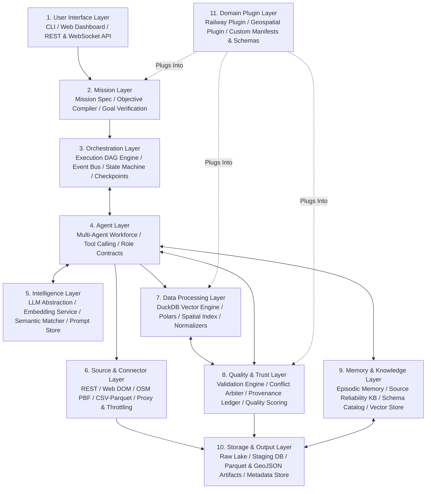
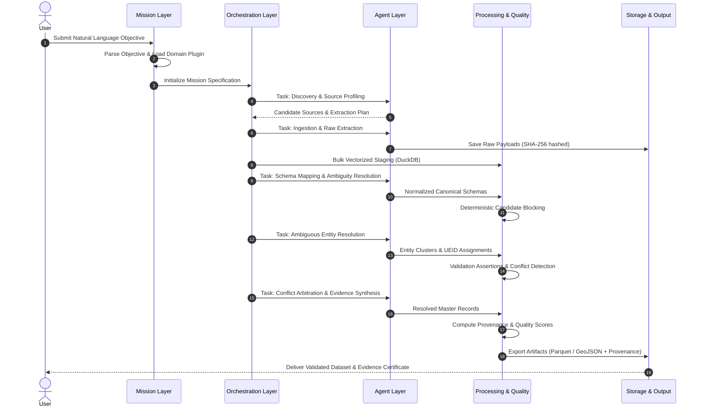

# Conceptual System Architecture

## 1. Architectural Philosophy and Design Principles

The Universal Data Collection & Intelligence Multi-Agent Engine (UDCM) is designed as an autonomous, domain-agnostic data intelligence operating system. Its primary architectural challenge is balancing **cognitive flexibility** (necessary to understand human intents, explore unstructured web sources, and interpret dirty schemas) with **deterministic execution guarantees** (essential for high-throughput, reproducible, hallucination-free data engineering).

### Key Architectural Tenets:
1. **Domain-Agnostic Core**: The core orchestrator and data engines know nothing about specific domains (such as railways, medical records, or meteorological grids). All domain rules, ontologies, and specialized parsing routines are loaded dynamically via the **Domain Plugin Layer**.
2. **Cognitive-Deterministic Partitioning**: LLMs are strictly confined to perception, planning, semantic mapping, and ambiguity resolution. All bulk data manipulation (filtering, spatial indexing, joins, statistical aggregation) is offloaded to native compiled vectorized engines.
3. **Closed-Loop Feedback & Self-Correction**: Pipeline stages are not passive one-way pipes. Downstream validation and conflict detection actively communicate with upstream planning agents to request additional data, trigger alternative sources, or refine filters.
4. **W3C PROV-Compliant Traceability**: Every record, attribute, and transformation maintains an unbroken lineage trail back to the raw byte payload and the specific agent decision that accepted it.

---

## 2. 11-Layer Conceptual Architecture

The diagram below illustrates the 11 functional layers of UDCM and their directional interactions.

---

## 3. Detailed Specification of the 11 Layers

### Layer 1: User Interface Layer
* **Components**:
  * `UDCM CLI`: Terminal-based interface for mission initiation, interactive monitoring, and configuration.
  * `FastAPI REST & WebSocket Server`: Async API for programmatic integration and real-time streaming mission telemetry.
  * `Web Mission Control (Future)`: Interactive mission dashboard displaying live agent logs, DAG execution status, data profiling charts, and interactive entity reconciliation tools.
* **Responsibilities**: Accept natural language objectives from users, display real-time execution progress, solicit human clarification when agents flag irreconcilable ambiguities, and deliver final data bundles.

### Layer 2: Mission Layer
* **Components**:
  * `Objective Parser`: Deconstructs natural language inputs into structured domain constraints, target geometries, required entity types, and quality tolerances.
  * `Mission Specification Model`: Strongly-typed Pydantic model (`MissionSpec`) declaring the mission's scope, budget, and acceptance criteria.
  * `Mission Verifier`: Evaluates whether the generated output dataset satisfies the user's initial objective constraints.
* **Responsibilities**: Translates open-ended user requests into concrete, verifiable data contracts.

### Layer 3: Orchestration Layer
* **Components**:
  * `Adaptive DAG Scheduler`: Dynamically builds, modifies, and traverses the execution graph of tasks.
  * `Mission State Machine`: Manages deterministic mission transitions (`INITIALIZING`, `DISCOVERING`, `EXTRACTING`, `NORMALIZING`, `RESOLVING`, `VALIDATING`, `FINALIZING`, `FAILED`, `COMPLETED`).
  * `Checkpoint & Rollback Manager`: Persists state snapshots at stage boundaries to enable zero-loss resumption after network or machine failures.
  * `Async Event Bus`: Internal pub/sub channel for decoupling agent messages, stage completion notifications, and telemetry.
* **Responsibilities**: Coordinates agent lifecycles, ensures operational idempotency, and manages execution flow.

### Layer 4: Agent Layer
* **Components**:
  * The multi-agent workforce comprising 12 specialized agents (detailed in `docs/AGENT_ARCHITECTURE.md`):
    * `Orchestrator Agent`
    * `Discovery Agent`
    * `Research Agent`
    * `Source Intelligence Agent`
    * `Extraction Agent`
    * `Schema Intelligence Agent`
    * `Normalization Agent`
    * `Entity Resolution Agent`
    * `Validation Agent`
    * `Conflict Resolution Agent`
    * `Enrichment Agent`
    * `Quality Agent`
* **Responsibilities**: Execute assigned mission steps by invoking deterministic tools, generating reasoning logs, and collaborating with peer agents.

### Layer 5: Intelligence Layer
* **Components**:
  * `Unified LLM Gateway`: Provider-agnostic abstraction (via LiteLLM / custom interface) supporting local models (Ollama, vLLM) and hosted frontier APIs (Gemini, Claude, GPT).
  * `Embedding & Semantic Service`: Computes dense vector representations for schema column names, entity names, and text descriptions.
  * `Prompt & Template Engine`: Versioned, validated prompt templates with few-shot examples and strict schema outputs (Pydantic / JSON Schema structured generation).
  * `Token & Cost Governor`: Tracks prompt and completion token expenditure per mission, enforcing strict cost ceilings.
* **Responsibilities**: Provides robust, provider-swappable cognitive and semantic capabilities to the Agent Layer.

### Layer 6: Source & Connector Layer
* **Components**:
  * `Protocol Adapters`: HTTP/HTTPS, REST, GraphQL, WebSocket, FTP/SFTP, S3/Blob storage.
  * `Format Unpackers`: JSON, CSV/TSV, XML, HTML Tables, GeoJSON, OSM PBF, Shapefile, Parquet.
  * `Web Automation Engine`: Headless browser control (Playwright/Chrome CDP) for dynamic JavaScript-heavy single-page applications.
  * `Network Governance & Throttling`: Robots.txt parser, token bucket rate limiters, exponential backoff, user-agent rotation, proxy pool manager.
* **Responsibilities**: Executes physical raw byte extraction across uncoordinated internet endpoints while enforcing ethical scraping standards.

### Layer 7: Data Processing Layer
* **Components**:
  * `Embedded Columnar Engine (DuckDB)`: High-performance vectorized SQL engine for in-process analytical transformations, joins, and aggregations.
  * `Dataframe Engine (Polars)`: Fast memory-efficient dataframe manipulation for batch record transformations.
  * `Spatial Index & Geometry Engine (Shapely/GEOS)`: R-tree indexing, polygon point-in-polygon checks, coordinate reprojection (EPSG transforms), and spatial buffering.
  * `String & Phonetic Processing Unit`: Deterministic algorithms (Jaro-Winkler, Levenshtein, Double Metaphone, N-Gram tokenizers) for fuzzy matching.
* **Responsibilities**: High-speed, deterministic batch processing of records, keeping token costs and latency low.

### Layer 8: Quality & Trust Layer
* **Components**:
  * `Declarative Validation Engine`: Evaluates syntactic constraints (types, nullability, unique keys, regex patterns) and domain constraints (valid coordinates, physical bounds).
  * `Cross-Source Conflict Arbiter`: Identifies attribute discrepancies across distinct sources and applies multi-source truth discovery algorithms.
  * `Provenance & Lineage Ledger`: W3C PROV-DM graph recording the exact derivation history of every cell, record, and dataset artifact.
  * `Composite Quality Scorer`: Calculates quantifiable scores (0.0 to 1.0) across Completeness, Validity, Consistency, Timeliness, and Accuracy.
* **Responsibilities**: Guarantees the mathematical, semantic, and evidentiary integrity of the collected data.

### Layer 9: Memory & Knowledge Layer
* **Components**:
  * `Source Reliability Knowledge Base`: Historical records of source availability, uptime, schema stability, data quality scores, and rate limit tolerances.
  * `Schema Correspondence Registry`: Repository of discovered cross-domain schema mappings (e.g., mapping `stn_cd` $\leftrightarrow$ `railway_code`).
  * `Episodic Mission Memory`: Vectorized semantic memory of past missions, natural language objectives, execution plans, and encountered pitfalls.
* **Responsibilities**: Enables the system to learn from experience and become faster and more reliable over time.

### Layer 10: Storage & Output Layer
* **Components**:
  * `Raw Data Lake`: Content-addressed storage storing raw, uncompressed bytes of every downloaded payload with cryptographic SHA-256 hashes.
  * `Intermediate Staging Store`: DuckDB / SQLite staging tables for in-flight mission transformations.
  * `Artifact Exporter`: Packages final clean datasets into GeoJSON, Parquet, CSV, SQLite, and DuckDB formats.
  * `Evidence Package Builder`: Generates verification certificates, data dictionaries, and W3C PROV lineage graphs accompanying the data release.
* **Responsibilities**: Manages physical persistence, intermediate caching, and client artifact delivery.

### Layer 11: Domain Plugin Layer
* **Components**:
  * `Plugin Interface Contract`: Abstract protocol defining domain schemas, custom validation assertions, domain-specific extractors, and ontology links.
  * `Railway Domain Plugin (Reference Plugin)`: Implements railway-specific schemas (Station, Track, Yard, Platform), spatial CRS logic, Overpass API query templates, and Indian Railways / global railway validation rules.
  * `Plugin Manifest Registry`: Auto-discovers and registers external plugins at startup.
* **Responsibilities**: Encapsulates all domain-specific assumptions cleanly outside the UDCM core engine.

---

## 4. End-to-End Architectural Data Flow

---

## 5. Architectural Contradiction Analysis & Resolutions

During Phase 0 architecture design, four potential architectural contradictions were identified and formally resolved:

1. **Autonomous Agency vs. High-Throughput Batch Processing**:
   * *Contradiction*: AI agents operating sequentially on individual records via LLM API calls cannot scale to datasets with hundreds of thousands of records.
   * *Resolution*: Strict **Role Segregation**. Agents operate as *planners, arbiters, and code generators*, never as *row-by-row data processors*. All row-level operations are compiled into vectorized SQL/dataframe expressions executed by DuckDB/Polars.
2. **Domain-Agnostic Core vs. Specialized Domain Requirements**:
   * *Contradiction*: Without domain knowledge, an engine cannot validate whether a railway station has a valid track gauge or if coordinates fall within Tamil Nadu.
   * *Resolution*: **Inversion of Control via Plugins**. The core provides generic validation engines (spatial polygons, range checks, regex); the Domain Plugin supplies the specific polygon geometry, dictionary rules, and gauge definitions via standard declarative contracts.
3. **Dynamic Self-Healing vs. Deterministic Reproducibility**:
   * *Contradiction*: If agents adaptively re-plan and change sources dynamically, two runs might produce different datasets.
   * *Resolution*: **Immutable Mission Ledgers**. During execution, every agent plan decision, raw download, and model output is logged to the mission checkpoint. Re-running a completed mission in replay mode uses the exact logged decisions and cached raw payloads, guaranteeing deterministic output.
4. **Autonomous Web Discovery vs. Ethical/Legal Safety**:
   * *Contradiction*: Autonomous scrapers might violate site terms, download copyrighted materials, or trigger denial-of-service on small endpoints.
   * *Resolution*: **Hard Deterministic Safety Guardrails**. Network calls pass through a non-overridable Governance Middleware enforcing robots.txt, rate limits, domain exclusion lists, and size limits before an agent can issue an HTTP request.
