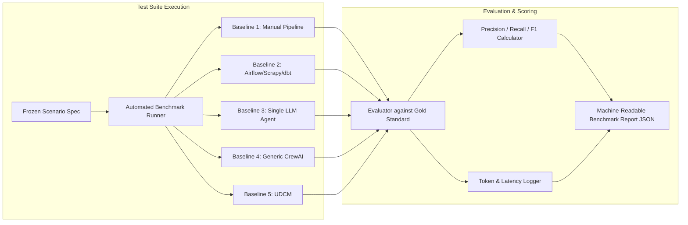

# Empirical Research & Benchmark Strategy

## 1. Benchmarking Philosophy & Integrity

To establish valid scientific credibility, UDCM avoids subjective demonstrations or selective cherry-picking. All future evaluations must adhere to the following principles:
1. **No Fabricated Data**: This document specifies the *evaluation protocol, baselines, metrics, and experimental designs*. No hypothetical benchmark scores or fabricated performance metrics are reported as realized facts.
2. **Reproducibility**: All benchmark scenarios must be accompanied by frozen data snapshots, deterministic evaluation scripts, and fixed random seeds.
3. **Comparative Evaluation**: UDCM must be evaluated directly against established alternative approaches across identical datasets and problem statements.

---

## 2. Baseline Systems for Comparison

To quantify the value added by UDCM's multi-agent architecture and hybrid design, performance will be benchmarked against five distinct baselines:

### Baseline 1: Manual Human Pipeline (Manual Data Engineering)
* **Description**: A competent human data engineer manually searches for sources, writes custom scraping/API scripts, inspects schemas, writes SQL/Python transformations, resolves duplicates using ad-hoc scripts, and formats the output.
* **Represents**: The traditional human engineering baseline.

### Baseline 2: Traditional Static ETL Pipeline (e.g., Airflow + Scrapy + dbt)
* **Description**: A pre-authored, fixed pipeline of Scrapy spiders, dbt transformations, and Great Expectations assertions orchestrated by Airflow.
* **Represents**: State-of-the-art deterministic data engineering without runtime cognitive adaptation.

### Baseline 3: Single-Agent Monolithic LLM Approach (e.g., Prompted GPT-4 / Claude)
* **Description**: A single monolithic agent given web browsing tools, python execution environment, and the user objective, asked to produce the dataset in a single conversational thread without role division.
* **Represents**: Naive agentic problem solving.

### Baseline 4: Generalized Multi-Agent Swarm (e.g., Generic CrewAI / AutoGen)
* **Description**: A standard multi-agent role-playing framework without UDCM's specialized data processing layer, lacking DuckDB columnar staging, deterministic blocking, or W3C PROV ledger.
* **Represents**: Conversational multi-agent systems without domain-specific data engineering architecture.

### Baseline 5: UDCM (Proposed System)
* **Description**: The full UDCM engine featuring domain-agnostic core, 12 specialized agents, hybrid cognitive-deterministic partitioning, and W3C PROV evidence ledger.

---

## 3. Quantitative Evaluation Metrics

Every benchmark run will record the following 13 standardized metrics:

| Metric ID | Metric Name | Unit / Scale | Measurement Method |
| :--- | :--- | :--- | :--- |
| **MET-01** | **Human Configuration Effort** | Minutes / Lines of Code | Active developer time required from prompt to working pipeline. |
| **MET-02** | **Collection Latency** | Wall-clock seconds | Total elapsed execution time to acquire raw and staged records. |
| **MET-03** | **Source Coverage** | Percentage ($0 - 100\%$) | Ratio of successfully discovered authoritative sources to a pre-defined gold-standard source registry. |
| **MET-04** | **Schema Mapping Precision / Recall / F1** | Score ($0.0 - 1.0$) | Match accuracy of source attributes mapped to canonical target schema vs. verified ground truth. |
| **MET-05** | **Entity Resolution F1** | Score ($0.0 - 1.0$) | Harmonic mean of pairwise match Precision and Recall evaluated against gold-standard entity clusters. |
| **MET-06** | **Duplicate Reduction Ratio** | Percentage ($0 - 100\%$) | True positive duplicates merged divided by total duplicates present in multi-source raw corpus. |
| **MET-07** | **Validation Accuracy** | Percentage ($0 - 100\%$) | Proportion of syntactically or topologically invalid records accurately detected and isolated. |
| **MET-08** | **Data Completeness** | Score ($0.0 - 1.0$) | Percentage of mandatory and optional schema attributes populated with valid (non-null) data. |
| **MET-09** | **Composite Quality Score** | Score ($0.0 - 1.0$) | Weighted index combining Completeness, Accuracy, Spatial Validity, and Source Corroboration. |
| **MET-10** | **Fault Recovery Rate** | Percentage ($0 - 100\%$) | Proportion of simulated source failures (HTTP 429, schema drift, dead links) recovered without pipeline failure. |
| **MET-11** | **Human Intervention Frequency** | Integer count | Number of manual human interventions required during execution to resolve deadlocks or errors. |
| **MET-12** | **Agent Cost Efficiency** | USD ($) / Token Count | Total input/output LLM tokens consumed and estimated API monetary cost per 1,000 entities. |
| **MET-13** | **Domain Adaptation Time** | Hours | Engineering time required to author a new domain plugin for an unencountered subject area. |

---

## 4. Benchmark Domains and Scenario Design

Evaluation will be conducted sequentially across five distinct domain environments:

### Domain 1: Railway Infrastructure (Initial Benchmark Domain)
* **Grounding Context**: Inherited from RI-data-Collector explorations.
* **Test Mission Objective**: *"Collect all railway stations in Tamil Nadu, combine reliable sources (OpenStreetMap/Overpass, GeoFabrik, official Indian Railways public registries), deduplicate stations, verify geographic coordinates within Tamil Nadu state boundaries, and produce a clean GeoJSON dataset with station codes, names, gauges, and zone attributes."*
* **Key Challenges**:
  * Multilingual station names (English, Tamil, Hindi).
  * Multiple historical naming conventions (e.g., Madras Central vs Chennai Central).
  * Disparate sources: Overpass API (OSM nodes/ways), static PDF/CSV station registries, GeoFabrik PBF extracts.
  * Spatial validation: Coordinate bounding box and point-in-polygon tests.
* **Ground Truth Dataset**: Manually verified gold-standard corpus of Tamil Nadu railway stations with verified EPSG:4326 coordinates and Indian Railways station codes.

### Domain 2: Geospatial & Protected Natural Areas (Future Domain)
* **Test Mission Objective**: *"Collect all national parks, wildlife sanctuaries, and reserved forests in South India with boundary polygons, administrative managing bodies, and notification years."*
* **Key Challenges**: Complex spatial polygon geometries, overlapping administrative definitions, boundary reconciliation across local and international repositories.

### Domain 3: Meteorological & Weather Stations (Future Domain)
* **Test Mission Objective**: *"Harvest active surface weather observation stations and historic 30-day precipitation readings for the Western Ghats basin from open weather feeds, WMO registries, and regional flood portals."*
* **Key Challenges**: Time-series data streams, disparate unit systems (inches vs millimeters, Fahrenheit vs Celsius), sensor drift anomalies.

### Domain 4: Agricultural Market Prices & Mandis (Future Domain)
* **Test Mission Objective**: *"Aggregate daily wholesale commodity prices across agricultural markets (mandis) in Maharashtra, harmonizing commodity variety names, trade units, and market locations."*
* **Key Challenges**: Severe textual ambiguity, non-standard unit names (quintal, bag, crate), high schema noise, localized vernacular commodity names.

### Domain 5: Open E-Commerce Product Registry (Future Domain)
* **Test Mission Objective**: *"Construct a catalog of consumer electronics (specifically smartphones) sold across three distinct open retail catalogs, reconciling brand, model, SKU, RAM/storage variants, and pricing."*
* **Key Challenges**: Extreme record scale ($>10^5$), high rate of missing specifications, marketing title noise, aggressive anti-bot protections.

---

## 5. Experimental Test Matrix & Protocol

### Fault Injection Suite
To evaluate **MET-10 (Fault Recovery Rate)**, the benchmark suite will inject controlled synthetic anomalies during the extraction and schema stages:
1. **HTTP 429 / 503 Injection**: Proxies simulate temporary endpoint outages and aggressive rate-limiting.
2. **Schema Drift Injection**: Renaming or dropping 30% of source columns mid-mission.
3. **Dirty Data Injection**: Injecting swapped lat/long coordinates, malformed Unicode strings, and synthetic duplicates.
4. **Endpoint Disappearance**: Simulating total DNS failure on primary candidate sources to test automatic fallback to secondary sources.

---

## 6. Execution Timeline & Milestones

* **Phase 0 (Current)**: Benchmark protocol and metric formulas formally specified.
* **Phase 1**: Construct gold-standard validation dataset for Domain 1 (Railway).
* **Phase 2**: Implement deterministic evaluation runner (`benchmarks/runner.py`) and establish Baselines 1, 2, and 3.
* **Phase 3**: Execute comparative benchmarks for UDCM against all baselines on Domain 1.
* **Phase 4**: Expand benchmarks to Domains 2–5 for cross-domain generalization evaluation.
