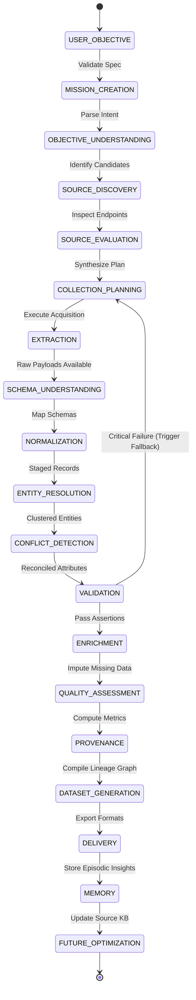

# End-to-End Data Lifecycle Specification

## 1. Overview and Lifecycle Paradigm

The UDCM data lifecycle defines the complete journey of information: from an initial, underspecified natural language user prompt to a certified, provenance-backed, production-grade dataset, and finally into the system's long-term episodic memory for future mission optimization.

The lifecycle comprises **19 distinct sequential and reactive states**:

```
USER OBJECTIVE
  ↓
MISSION CREATION
  ↓
OBJECTIVE UNDERSTANDING
  ↓
SOURCE DISCOVERY
  ↓
SOURCE EVALUATION
  ↓
COLLECTION PLANNING
  ↓
EXTRACTION
  ↓
SCHEMA UNDERSTANDING
  ↓
NORMALIZATION
  ↓
ENTITY RESOLUTION
  ↓
CONFLICT DETECTION
  ↓
VALIDATION
  ↓
ENRICHMENT
  ↓
QUALITY ASSESSMENT
  ↓
PROVENANCE
  ↓
DATASET GENERATION
  ↓
DELIVERY
  ↓
MEMORY
  ↓
FUTURE OPTIMIZATION
```

---

## 2. State Transition Model



---

## 3. Detailed Lifecycle Stages: Inputs, Outputs & State Transitions

### Stage 1: USER OBJECTIVE
* **Input**: Unstructured natural language text submitted by user via CLI, API, or Dashboard (e.g., *"Collect all railway stations in Tamil Nadu, combine reliable sources, remove duplicates, verify coordinates, and give me a clean GeoJSON dataset"*).
* **Processing**: Initial tokenization and sanitization; boundary check.
* **Output**: `RawObjective` object.
* **Next State**: `MISSION_CREATION`

### Stage 2: MISSION CREATION
* **Input**: `RawObjective`, User Session context, API configuration.
* **Processing**: Instantiate unique `mission_id` (UUIDv7), allocate workspace directory, create SQLite/DuckDB mission state tracking catalog.
* **Output**: `MissionContext` with state `INITIALIZING`.
* **Next State**: `OBJECTIVE_UNDERSTANDING`

### Stage 3: OBJECTIVE UNDERSTANDING
* **Input**: `MissionContext`.
* **Processing**: Orchestrator invokes LLM semantic parsing against loaded Domain Plugin manifests. Deconstructs objective into:
  * Target Entity Types (e.g., `RailwayStation`)
  * Spatial Boundary (e.g., Tamil Nadu polygon / bounding box `[76.2, 8.0, 80.3, 13.5]`)
  * Mandatory Attributes (e.g., `name`, `code`, `coordinates`, `zone`)
  * Target Output Formats (e.g., `GeoJSON`, `Parquet`)
  * Quality Thresholds (e.g., `min_completeness=0.90`)
* **Output**: `MissionSpecification` (immutable Pydantic model).
* **Next State**: `SOURCE_DISCOVERY`

### Stage 4: SOURCE DISCOVERY
* **Input**: `MissionSpecification`.
* **Processing**: Discovery Agent queries public web search engines, OpenStreetMap Overpass endpoints, CKAN open data portals, and government spatial catalogs for endpoints covering the target entity and spatial scope.
* **Output**: Ranked list of `CandidateSource` records with source URLs and discovered metadata.
* **Next State**: `SOURCE_EVALUATION`

### Stage 5: SOURCE EVALUATION
* **Input**: `CandidateSource[]`.
* **Processing**: Source Intelligence Agent and Research Agent probe endpoints for:
  * Availability and latency (`HEAD` request probe)
  * Licensing and terms of service (ODbL, CC-BY, public domain)
  * Structural format (GeoJSON feed, Overpass OSM XML, static CSV download, HTML table)
  * Historical reliability score retrieved from Memory Layer
* **Output**: `EvaluatedSource[]` with capability flags, rate-limit policies, and assigned trustworthiness weights.
* **Next State**: `COLLECTION_PLANNING`

### Stage 6: COLLECTION PLANNING
* **Input**: `EvaluatedSource[]`, `MissionSpecification`.
* **Processing**: Orchestrator synthesizes an optimized acquisition DAG:
  * Designates Primary Sources vs. Secondary/Validation Sources
  * Configures extraction methods and concurrency/rate-limit constraints
  * Establishes fallback pathways if a primary source fails
* **Output**: `CollectionPlan` DAG.
* **Next State**: `EXTRACTION`

### Stage 7: EXTRACTION
* **Input**: `CollectionPlan`.
* **Processing**: Extraction Agent executes asynchronous network acquisition:
  * Downloads raw data streams via HTTP/HTTPS, Overpass API, or Headless Browser
  * Calculates cryptographic SHA-256 digests
  * Writes unaltered raw bytes directly to Content-Addressed Storage (`data/raw/<sha256>`)
* **Output**: `RawPayloadReceipt[]` containing file paths, byte sizes, hashes, and network headers.
* **Next State**: `SCHEMA_UNDERSTANDING`

### Stage 8: SCHEMA UNDERSTANDING
* **Input**: `RawPayloadReceipt[]`, Domain Plugin Canonical Schema.
* **Processing**: Schema Intelligence Agent parses payload samples using DuckDB sniffer:
  * Infers column datatypes and nested structures
  * Identifies semantic equivalents (e.g., `stn_name` $\leftrightarrow$ `name`, `latitude_wgs84` $\leftrightarrow$ `lat`)
  * Formulates deterministic transformation and projection rules
* **Output**: `SourceToCanonicalSchemaMapping[]`.
* **Next State**: `NORMALIZATION`

### Stage 9: NORMALIZATION
* **Input**: Raw payloads, `SourceToCanonicalSchemaMapping[]`.
* **Processing**: Normalization Agent executes high-throughput vectorized DuckDB/Polars SQL queries:
  * Standardizes text encodings (UTF-8, Unicode NFC)
  * Standardizes casing and whitespace stripping
  * Converts geographic coordinates to standard WGS84 (`EPSG:4326`) format
  * Stages clean rows into uniform intermediate DuckDB tables
* **Output**: `StagedNormalizedTable` with standard columns.
* **Next State**: `ENTITY_RESOLUTION`

### Stage 10: ENTITY RESOLUTION
* **Input**: `StagedNormalizedTable`.
* **Processing**: Entity Resolution Agent dedupes records across sources:
  1. Spatial and phonetic candidate blocking ($O(N^2) \rightarrow O(N)$)
  2. Multi-attribute similarity scoring (Levenshtein, Jaro-Winkler, Haversine distance)
  3. LLM arbitration strictly for ambiguous candidate pairs
  4. Graph-based clustering (connected components)
  5. Assignment of Universal Entity Identifiers (`UEID`)
* **Output**: `EntityClusterGraph` linking duplicate records across sources.
* **Next State**: `CONFLICT_DETECTION`

### Stage 11: CONFLICT DETECTION
* **Input**: `EntityClusterGraph`, `StagedNormalizedTable`.
* **Processing**: Compares attribute values within each entity cluster across distinct sources. Flags discrepancies (e.g., Source A states 3 platforms, Source B states 5; coordinate offset $> 250$ meters).
* **Output**: `DetectedConflictSet` detailing field-level disagreements.
* **Next State**: `VALIDATION`

### Stage 12: VALIDATION
* **Input**: Candidate clustered entities, `DetectedConflictSet`, Domain Validation Assertions.
* **Processing**: Validation Agent evaluates declarative assertions:
  * Spatial bounds: Are all coordinates inside the Tamil Nadu polygon boundary?
  * Structural checks: Are mandatory fields present?
  * Domain logic: Do railway station codes adhere to official railway formats?
* **Decisional Branching**:
  * If critical errors occur (e.g., $>50\%$ of records fail coordinates): Triggers rollback to `COLLECTION_PLANNING` with alternative source selection.
  * If valid within error tolerance: Proceed to `ENRICHMENT`.
* **Output**: `ValidationReport` and clean candidate records.
* **Next State**: `ENRICHMENT` (or `COLLECTION_PLANNING` on failure)

### Stage 13: ENRICHMENT
* **Input**: Validated entity records with sparse or missing attributes.
* **Processing**: Enrichment Agent conducts non-destructive augmentation:
  * Spatial join against administrative district polygons to fill missing district/taluk names
  * Query external knowledge bases (e.g., Wikidata SPARQL) for missing official multilingual names or electrification status
* **Output**: Fully populated `EnrichedMasterRecordSet`.
* **Next State**: `QUALITY_ASSESSMENT`

### Stage 14: QUALITY ASSESSMENT
* **Input**: `EnrichedMasterRecordSet`, `ValidationReport`, `DetectedConflictSet`.
* **Processing**: Quality Agent computes quantifiable quality vector per entity and across the dataset:
  * Completeness Score ($C \in [0, 1]$)
  * Spatial Precision & Validity Score ($S \in [0, 1]$)
  * Multi-Source Corroboration Score ($M \in [0, 1]$)
  * Composite Trust Index ($Q \in [0, 1]$)
* **Output**: `DataQualityScorecard` and entity-level confidence ratings.
* **Next State**: `PROVENANCE`

### Stage 15: PROVENANCE
* **Input**: Execution history, raw receipts, mapping rules, entity clusters, quality scores.
* **Processing**: Quality Agent serializes an end-to-end W3C PROV-DM graph:
  * Maps every output attribute to source entity, transformation agent, and source hash
  * Records explanation briefs for all conflict resolution arbitrations
* **Output**: `lineage_prov.json` and verification certificate.
* **Next State**: `DATASET_GENERATION`

### Stage 16: DATASET GENERATION
* **Input**: `EnrichedMasterRecordSet`, `DataQualityScorecard`, `lineage_prov.json`.
* **Processing**: Export engine packages physical target datasets in requested formats:
  * `output.geojson` (with rich feature properties and confidence scores)
  * `output.parquet` (compressed columnar format)
  * `output.csv` (accessible tabular format)
  * `metadata.json` (data dictionary, license attribution, bounding box)
* **Output**: Final Release Bundle in `data/processed/<mission_id>/`.
* **Next State**: `DELIVERY`

### Stage 17: DELIVERY
* **Input**: Release Bundle.
* **Processing**: Deliver dataset path to user via CLI output, REST response, or WebSocket event stream. Display executive summary of records collected, duplicates merged, and quality score.
* **Output**: User delivery confirmation.
* **Next State**: `MEMORY`

### Stage 18: MEMORY
* **Input**: Mission performance telemetry, source reliability updates, schema mapping rules.
* **Processing**: Memory Layer writes mission learnings to persistent catalog:
  * Updates source uptime and accuracy ratings in Source KB
  * Saves successful schema translation pairs to Schema Catalog
  * Indexes mission objective and execution DAG in Episodic Vector Store
* **Output**: Persisted memory records.
* **Next State**: `FUTURE_OPTIMIZATION`

### Stage 19: FUTURE OPTIMIZATION
* **Input**: Memory updates.
* **Processing**: Background optimization routines update source confidence priors, refine crawler delay heuristics, and prune unreliable data providers.
* **Output**: Updated engine priors ready for subsequent missions.
* **Next State**: `[TERMINAL: COMPLETED]`
