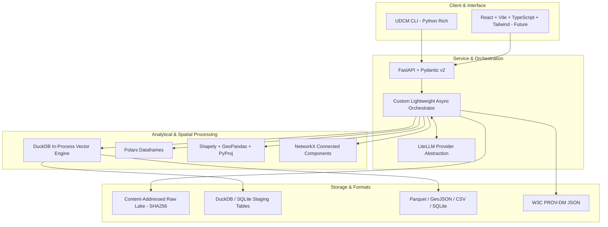

# Technology Stack Evaluation & Architectural Decision Records

## 1. Principles of Technology Selection

UDCM adheres to rigorous engineering pragmatism:
1. **Zero Unnecessary Dependencies**: Every library or runtime dependency must justify its presence against operational complexity and maintenance overhead.
2. **Deterministic-First Performance**: In-process, vectorized, compiled engines (Rust/C++) are preferred for high-volume data manipulations over interpreted loops or heavy distributed clusters.
3. **Vendor Independence**: Core logic must remain completely decoupled from specific cloud vendors, proprietary LLM APIs, and closed platforms.
4. **Local Development Parity**: The complete system must run locally in a developer environment (using embedded DuckDB/SQLite) without mandating external cloud services.

---

## 2. Technology Decision Matrix

### 2.1 Core Backend Language & API Framework

| Dimension | Python 3.11+ | Rust / Go | FastAPI | Node.js / TypeScript |
| :--- | :--- | :--- | :--- | :--- |
| **Why Considered** | Premier ecosystem for AI, data science, geospatial, and ML libraries. | Maximum concurrency and execution speed. | Modern, async, typed OpenAPI backend framework. | Fast event loop, unified language if using React. |
| **Advantages** | Unrivaled ecosystem (Shapely, Polars, DuckDB, LiteLLM, NetworkX); fast research iteration. | Memory safety, zero GIL, high CPU performance. | Pydantic native integration, async ASGI, automatic docs, high throughput. | Rich web ecosystem, shared types with UI. |
| **Disadvantages** | Python GIL (mitigated by using C++/Rust extensions like DuckDB/Polars). | Smaller AI/geospatial library ecosystem; slower iteration speed. | Requires careful async/await boundary management. | Weaker native scientific/geospatial and tabular analytical libraries. |
| **Cost / License** | Free (Open Source) | Free (Open Source) | Free (MIT) | Free (Open Source) |
| **Lock-in Risk** | None | None | None | None |
| **Complexity** | Low | High | Low | Medium |
| **Suitability** | **Extremely High (Primary Backend)** | Low for core logic; high for targeted extensions | **Extremely High (API Layer)** | Low for backend engine |
| **Final Decision** | **ADOPTED (Python 3.11+)** | **DEFERRED (Evaluate for C-extensions if needed)** | **ADOPTED (FastAPI + Pydantic v2)** | **REJECTED (Backend)** |
| **Status** | Approved | Deferred | Approved | Rejected |

---

### 2.2 Data Processing & Intermediate Storage Engine

| Dimension | DuckDB | Polars | PostgreSQL | Apache Spark / Ray |
| :--- | :--- | :--- | :--- | :--- |
| **Why Considered** | In-process vectorized analytical SQL engine ("SQLite for OLAP"). | Lightning-fast multithreaded Arrow dataframe library in Rust. | Standard relational DB with PostGIS for spatial data. | Distributed data processing for massive big data. |
| **Advantages** | Zero operational overhead, native Parquet/CSV querying, direct spatial support, sub-second execution. | Low memory consumption, zero-copy Arrow memory sharing with DuckDB, clean expression API. | Rock-solid ACID, PostGIS spatial indexing, mature client libraries. | Scales to petabytes across compute clusters. |
| **Disadvantages** | In-process concurrency constraints for concurrent web writes. | Not a full SQL catalog; single-machine memory bound. | Heavy external service requirement; high setup complexity in local tests. | Massive operational overhead, slow startup, JVM dependencies, severe overkill for single missions. |
| **Cost / License** | Free (MIT) | Free (MIT) | Free (PostgreSQL License) | Free (Apache 2.0) |
| **Lock-in Risk** | None | None | None | Medium |
| **Complexity** | Minimal (embedded) | Minimal (library) | Medium (external daemon) | Extremely High |
| **Suitability** | **Extremely High (Mission Staging & OLAP)** | **Extremely High (Batch Record Transforms)** | **High (Optional Production Store)** | **REJECTED (Premature Optimization)** |
| **Final Decision** | **ADOPTED (Core Analytical Engine)** | **ADOPTED (Vectorized Transforms)** | **ADOPTED (Optional Persistence Layer)** | **REJECTED** |
| **Status** | Approved | Approved | Approved (Secondary) | Rejected |

---

### 2.3 LLM Gateway & Semantic Intelligence

| Dimension | Custom Gateway + LiteLLM | LangChain / LlamaIndex | Direct Vendor SDKs (OpenAI/Anthropic) | Local Models (vLLM / Ollama) |
| :--- | :--- | :--- | :--- | :--- |
| **Why Considered** | Lightweight, vendor-agnostic proxy supporting 100+ LLM backends. | Popular high-level LLM orchestration frameworks. | Direct official vendor integration. | Zero external cost, offline execution, privacy. |
| **Advantages** | Standard OpenAI-compatible API interface; zero vendor lock-in; lightweight (~1 dependency). | Built-in abstractions for prompt chains and loaders. | Earliest access to newest proprietary model features. | Air-gapped execution; no per-token API charges; data sovereignty. |
| **Disadvantages** | Must handle custom fallback logic manually. | Heavy abstraction bloat; frequent breaking changes; opaque debugging. | Vendor lock-in; code rewrite required when switching providers. | Requires GPU hardware; lower reasoning performance than frontier models. |
| **Cost / License** | Free (MIT) | Free (MIT) | API usage fees | Free (Open Weights) |
| **Lock-in Risk** | Low | Medium-High | High | None |
| **Complexity** | Low | High | Low | Medium (Hardware dependent) |
| **Suitability** | **Extremely High (Gateway Layer)** | **REJECTED (Too bloated for core engine)** | **REJECTED as primary abstraction** | **ADOPTED (Supported Local Provider)** |
| **Final Decision** | **ADOPTED (LiteLLM Abstraction)** | **REJECTED** | **REJECTED (Wrapped by LiteLLM)** | **ADOPTED (Optional Local Backend)** |
| **Status** | Approved | Rejected | Rejected | Approved |

---

### 2.4 Multi-Agent Orchestration Layer

| Dimension | Custom Lightweight Orchestration | CrewAI / AutoGen / MetaGPT | Temporal.io / Prefect |
| :--- | :--- | :--- | :--- |
| **Why Considered** | Purpose-built for data mission DAGs with deterministic state machines and transactional boundaries. | Established multi-agent role-playing frameworks. | Industrial workflow engines for resilient distributed tasks. |
| **Advantages** | Complete control over token consumption, zero framework bloat, explicit deterministic boundaries, native DuckDB/W3C PROV integration. | Quick conversational agent prototyping out of the box. | Industrial-grade checkpointing, distributed retry queues, worker scaling. |
| **Disadvantages** | Must build state machine and scheduling logic internally. | Unpredictable agent-to-agent conversational loops; massive token waste; poor transactional data guarantees. | Significant infrastructure footprint (external services/daemons); overkill for initial development. |
| **Cost / License** | Free (Internal) | Free (MIT / Apache) | Free (MIT / BSL) |
| **Lock-in Risk** | None | Medium | Medium |
| **Complexity** | Low to Medium | Low initially, high to tame | High operational |
| **Suitability** | **Extremely High (Preferred for Core Engine)** | **REJECTED for Core Engine Runtime** | **DEFERRED for Multi-Node Scale** |
| **Final Decision** | **ADOPTED (Custom Mission Orchestrator)** | **REJECTED** | **DEFERRED** |
| **Status** | Approved | Rejected | Deferred |

---

### 2.5 Graph Analysis & Entity Clustering

| Dimension | NetworkX | Dedicated Graph DB (Neo4j) | PostgreSQL CTE / Relational Recursive |
| :--- | :--- | :--- | :--- |
| **Why Considered** | Standard Python graph library for connected components and entity clustering. | Enterprise property graph database. | SQL-native recursive query graph traversal. |
| **Advantages** | In-memory, zero infrastructure, rich graph algorithms (connected components, bipartite matching). | Cypher query language, enterprise scale for multi-billion node graphs. | Reuses existing relational storage. |
| **Disadvantages** | Bounded by single-machine memory (sufficient for $10^6$ nodes per mission). | Heavy external daemon, operational maintenance, overkill for single missions. | Clunky syntax for complex graph algorithms. |
| **Cost / License** | Free (BSD) | Free Community / Enterprise | Free (Open Source) |
| **Lock-in Risk** | None | Medium | None |
| **Complexity** | Low | High | Medium |
| **Suitability** | **Extremely High (Entity Clustering & Provenance)** | **REJECTED for Phase 0-2** | **Low for complex graphs** |
| **Final Decision** | **ADOPTED (NetworkX)** | **REJECTED** | **REJECTED** |
| **Status** | Approved | Rejected | Rejected |

---

### 2.6 Geospatial & Geometry Processing

| Dimension | Shapely + GeoPandas + PyProj | GDAL / OGR Direct Bindings |
| :--- | :--- | :--- |
| **Why Considered** | Standard, pythonic, robust GEOS wrappers for spatial calculations, buffering, and CRS transformations. | Low-level C/C++ geospatial geospatial translation library. |
| **Advantages** | Clean Pythonic API, vectorized spatial operations, active community, excellent documentation. | Extreme raw format reading capabilities. |
| **Disadvantages** | Slightly higher memory than raw C bindings. | Complex compilation, brittle C dependency installation on some platforms. |
| **Cost / License** | Free (BSD) | Free (MIT/X) |
| **Lock-in Risk** | None | None |
| **Complexity** | Low | High |
| **Suitability** | **Extremely High** | **Secondary (underlying dependency via Fiona/PyOGRIO)** |
| **Final Decision** | **ADOPTED** | **ADOPTED as underlying engine** |
| **Status** | Approved | Approved |

---

### 2.7 Frontend & Web Visualization (Future Implementation)

| Dimension | React + Vite + TypeScript + Tailwind + shadcn/ui | Streamlit / Gradio | Next.js Fullstack |
| :--- | :--- | :--- | :--- |
| **Why Considered** | Modern, responsive, decoupled single-page application standard. | Rapid Python-only data dashboard prototyping. | Fullstack React framework with SSR. |
| **Advantages** | Total UI control, exceptional performance, modular component library, clean separation from Python backend. | Fast Python-only prototyping. | Server-side rendering, integrated API routes. |
| **Disadvantages** | Requires separate Node.js build pipeline. | Brittle state management, slow execution, poor customization for multi-agent streaming telemetry. | Unnecessary complexity since backend is Python FastAPI. |
| **Cost / License** | Free (MIT) | Free (Apache 2.0) | Free (MIT) |
| **Lock-in Risk** | Low | Low | Medium |
| **Complexity** | Medium | Very Low | High |
| **Suitability** | **Extremely High (Web Dashboard Standard)** | **Useful for quick scratch prototypes** | **REJECTED (Redundant with FastAPI)** |
| **Final Decision** | **ADOPTED for Web Dashboard (Phase 3+)** | **EVALUATED for internal demo only** | **REJECTED** |
| **Status** | Approved for future UI | Scratch only | Rejected |

---

### 2.8 Packaging & Infrastructure

| Dimension | Docker + Docker Compose | Kubernetes | Poetry / Hatchling / Uv |
| :--- | :--- | :--- | :--- |
| **Why Considered** | Reproducible multi-platform containerization. | Cloud container orchestration. | Modern Python dependency and packaging tools. |
| **Advantages** | Standard, isolated, identical developer and production environments. | Multi-node autoscaling. | Fast dependency resolution, PEP 621 compliance (`pyproject.toml`). |
| **Disadvantages** | Slight virtualization overhead. | Extreme operational complexity, completely unjustified for Phase 0-2. | Tooling ecosystem variation. |
| **Cost / License** | Free (Apache/Docker) | Free (Apache 2.0) | Free (MIT) |
| **Lock-in Risk** | None | Low | None |
| **Complexity** | Low to Medium | Extremely High | Low |
| **Suitability** | **Extremely High (Containerization Standard)** | **REJECTED (Severe Overkill)** | **ADOPTED (Hatchling / Uv / Pip)** |
| **Final Decision** | **ADOPTED (Docker / Compose)** | **REJECTED** | **ADOPTED (`pyproject.toml` standard)** |
| **Status** | Approved | Rejected | Approved |

---

## 3. Technology Stack Summary

